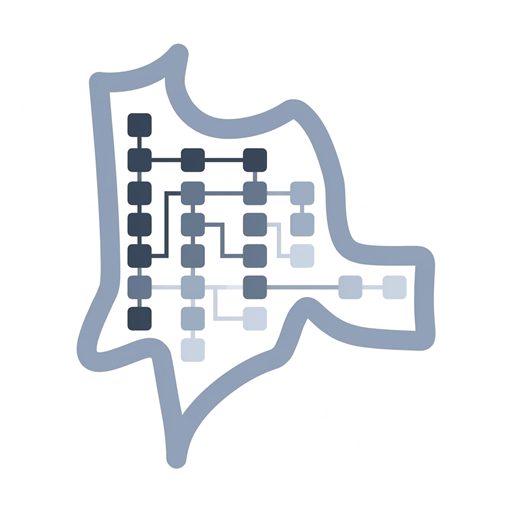

# Mi Malla (v1.2.0)

<p align="center">
  
</p>

<p align="center">
  Aplicación web progresiva (PWA) 100% offline para el seguimiento del plan de estudios de <strong>Administración de Empresas</strong> (referencia Sede Chía: 9 semestres, 158 créditos, 66 materias).
</p>

<p align="center">
  <a href="https://alekeyg.github.io/Mi_Malla/"><strong>Abrir Mi Malla en vivo</strong></a>
</p>

---

## Funciones principales

- **Malla curricular interactiva**: visualización de los 9 semestres (más semestres adicionales e intersemestrales) con desbloqueo automático según el grafo real de prerrequisitos.
- **Modos de interacción**:
  - **Modo normal**: consulta detalle, requisitos, notas y estado de cada materia.
  - **Modo ruta**: pulsa el botón **Modo Ruta** (en celular o PC) o mantén presionada una materia en celular para resaltar sus requisitos previos y las materias que desbloquea; toca cualquier materia para fijar o cambiar de ruta.
  - **Modo edición**: reorganiza materias entre semestres o hacia intersemestrales por arrastre (en celular sostén brevemente antes de arrastrar), con alertas de sobrecarga de 18 créditos y conflictos de requisitos en el mismo semestre.
- **Promedio ponderado y métricas**: cálculo automático del GPA semestral y acumulado (Art. 42 y Art. 44), avance por áreas temáticas y personalización de electivas.
- **Modo Simulación (*What-If*) y respaldo JSON**: prueba cambios sin alterar tu historial real y exporta/importa tu avance en `.json` desde **Ajustes** (almacenamiento 100% local en `IndexedDB`).

## Desarrollo local

```bash
npm install
npm run dev      # Servidor de desarrollo
npm test         # Pruebas unitarias (Vitest)
npm run lint     # Verificación de código (oxlint)
npm run build    # Compilación de producción y PWA
```

## Aviso legal y privacidad

- **Herramienta libre e independiente**: *Mi Malla* es un proyecto estudiantil gratuito para compartir libremente. No está afiliada, respaldada ni administrada oficialmente por la Universidad de Cundinamarca.
- **Enlaces externos**: los accesos del inicio dirigen únicamente a páginas y documentos públicos oficiales.
- **Privacidad**: todos los datos y calificaciones se guardan exclusivamente en el dispositivo del usuario; no se envía información a GitHub ni a servidores externos.
